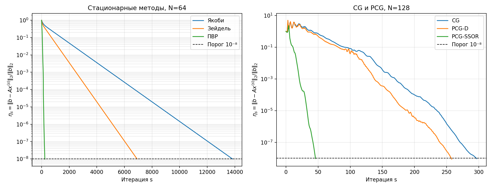
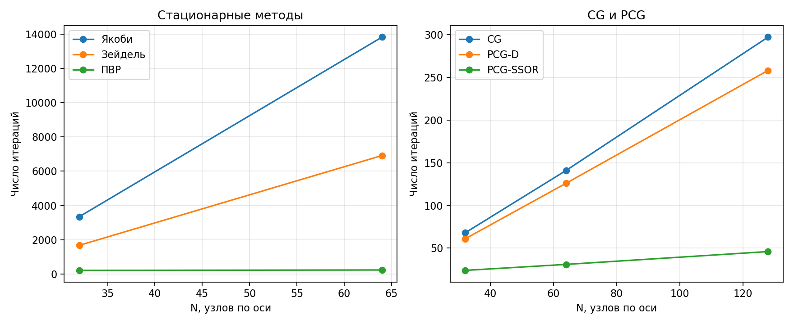
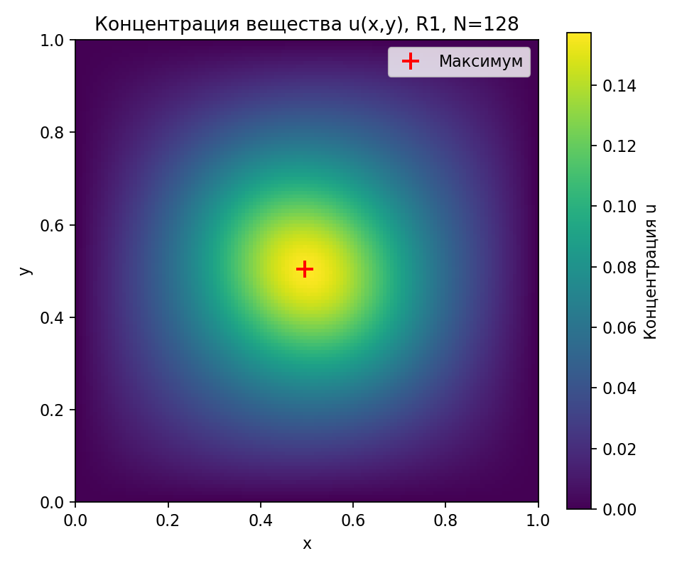

# Лабораторная работа №1 — вариант №11 (R1)

**Итерационные методы решения разреженных СЛАУ.** Исследуется диффузия вещества с поглощением в единичном квадрате:

$$
-\nabla\cdot(a\nabla u)+cu=f,\qquad u|_{\partial\Omega}=0.
$$

Для R1: $a=1+0.30\sin(2\pi x)\sin(2\pi y)$, $c=1$, $f=10\exp(-((x-0.5)^2+(y-0.5)^2)/0.02)$. Сетка содержит граничные узлы, число внутренних неизвестных $n=(N-2)^2$. Матрица хранится в CSR. Все итерационные методы стартуют с нуля и останавливаются при истинной нормированной невязке $\eta_s=\|b-Ax^{(s)}\|_2/\|b\|_2\leq10^{-8}$; превышение максимума итераций отмечается как несходимость.

## 8.1. Сборка матрицы

При N=8 получена матрица 36×36 с 156 ненулевыми элементами, не более 5 в строке. Относительная мера нарушения симметрии равна 2.654·10⁻¹⁷; минимальный диагональный элемент 151.632808. Для постоянного, знакопеременного и синусоидального векторов значения $z^TAz$ положительны (1212.000, 12972.000 и 250.024). Разложение Холецкого без диагонального сдвига успешно. Уравнение для m=14:

$$
-53.492764u_8-53.492764u_{13}+205.985529u_{14}-49u_{15}-49u_{20}=6.003730.
$$

Портрет матрицы: [изображение](lab1_stage_8_1_R1_spy.png). Исходный код: [этап 8.1](lab1_stage_8_1_R1.py).

## 8.2. Якоби, Зейдель и ПВР

На тестовой системе N=32 задано $u_m^*=1+\sin(2\pi m/n)+0.1\cos(6\pi m/n)$, $b^*=Au^*$. Здесь $\delta_s=\|u^*-x^{(s)}\|_2/\|u^*\|_2$ измеряет фактическую ошибку решения СЛАУ:

| Метод | Итераций | Порог η | Достигнутая ηₛ | δₛ |
| --- | --- | --- | --- | --- |
| Якоби | 2828 | 1e-08 | 9.977e-09 | 1.675e-07 |
| Зейдель | 1410 | 1e-08 | 9.904e-09 | 1.652e-07 |
| ПВР | 459 | 1e-08 | 9.881e-09 | 1.569e-07 |

Для R1 на N=64 проверены 11 значений $\omega$ в [1, 1.95], затем значения в окрестности лучшего с шагом 0.01. Наилучшее **среди проверенных**: $\omega=1.91$, 235 итераций. Это не теоретический оптимум.

| N | Метод | Итераций | Порог η | Достигнутая ηₛ | Время итераций, с |
| --- | --- | --- | --- | --- | --- |
| 32 | Якоби | 3344 | 1e-08 | 9.974e-09 | 0.061 |
| 32 | Зейдель | 1673 | 1e-08 | 9.976e-09 | 0.780 |
| 32 | ПВР | 212 | 1e-08 | 9.359e-09 | 0.100 |
| 64 | Якоби | 13828 | 1e-08 | 9.993e-09 | 0.560 |
| 64 | Зейдель | 6915 | 1e-08 | 9.994e-09 | 4.856 |
| 64 | ПВР | 235 | 1e-08 | 9.693e-09 | 0.164 |

Исходный код и полный поиск: [этап 8.2](lab1_stage_8_2_R1.py), [протокол](lab1_stage_8_2_R1_results.txt).

## 8.3. CG и PCG

Реализованы CG, PCG с диагональным предобуславливателем и PCG с SSOR. Последний применяется двумя разреженными треугольными решениями без формирования $P^{-1}$. Параметр SSOR подобран отдельно от параметра ПВР: среди 1.00, 1.20, 1.40, 1.60, 1.80, 1.90 на N=64 наименьшее число итераций (31) дало $\omega_{SSOR}=1.80$.

На тестовой системе N=32 оценка обусловленности равна $\mu_2(A)\approx462.3$. Для всех трёх методов достигнута невязка ниже 10⁻⁸, а фактическая ошибка согласуется с оценкой $\delta_s\leq\mu_2(A)\eta_s$:

| Метод | Итераций | Порог η | Достигнутая ηₛ | δₛ | μ₂ηₛ |
| --- | --- | --- | --- | --- | --- |
| CG | 112 | 1e-08 | 7.913e-09 | 6.085e-09 | 3.658e-06 |
| PCG-D | 103 | 1e-08 | 6.778e-09 | 5.800e-09 | 3.133e-06 |
| PCG-SSOR | 38 | 1e-08 | 7.064e-09 | 4.732e-09 | 3.266e-06 |

| N | Метод | Итераций | Порог η | Достигнутая ηₛ | Время итераций, с |
| --- | --- | --- | --- | --- | --- |
| 32 | CG | 68 | 1e-08 | 9.383e-09 | 0.002 |
| 32 | PCG-D | 61 | 1e-08 | 9.072e-09 | 0.002 |
| 32 | PCG-SSOR | 24 | 1e-08 | 4.366e-09 | 0.021 |
| 64 | CG | 141 | 1e-08 | 9.318e-09 | 0.007 |
| 64 | PCG-D | 126 | 1e-08 | 9.163e-09 | 0.007 |
| 64 | PCG-SSOR | 31 | 1e-08 | 5.770e-09 | 0.039 |
| 128 | CG | 297 | 1e-08 | 9.268e-09 | 0.087 |
| 128 | PCG-D | 258 | 1e-08 | 8.661e-09 | 0.103 |
| 128 | PCG-SSOR | 46 | 1e-08 | 9.383e-09 | 0.183 |

Полная таблица включает число matvec, время подготовки предобуславливателя, медиану времени итераций после пробного и трёх измерений, достигнутую невязку и память CSR: [протокол 8.3](lab1_stage_8_3_R1_results.txt), [исходный код](lab1_stage_8_3_R1.py).

## 8.4. Независимая проверка

Разреженный прямой решатель и библиотечный CG с rtol=10⁻¹⁰ использованы на N=32, 64, 128. Код возврата библиотечного CG равен нулю во всех случаях. Истинная невязка каждого контрольного решения пересчитана отдельно:

| N | Порог η | η прямого | Итераций библиотечного CG | η библиотечного CG |
| --- | --- | --- | --- | --- |
| 32 | 1e-10 | 1.893e-14 | 77 | 6.992e-11 |
| 64 | 1e-10 | 7.856e-14 | 160 | 8.943e-11 |
| 128 | 1e-10 | 3.253e-13 | 340 | 9.252e-11 |

Относительные расхождения собственных решений с прямым:

| N | Метод | L₂ | L∞ |
| --- | --- | --- | --- |
| 32 | CG | 2.052e-10 | 2.425e-10 |
| 32 | PCG-D | 2.452e-10 | 2.449e-10 |
| 32 | PCG-SSOR | 1.031e-10 | 1.211e-10 |
| 64 | CG | 1.648e-10 | 2.121e-10 |
| 64 | PCG-D | 1.740e-10 | 1.890e-10 |
| 64 | PCG-SSOR | 1.538e-10 | 1.549e-10 |
| 128 | CG | 1.339e-10 | 1.845e-10 |
| 128 | PCG-D | 1.175e-10 | 1.452e-10 |
| 128 | PCG-SSOR | 1.572e-10 | 1.699e-10 |

Максимальное расхождение по всем девяти сравнениям: 2.452e-10 в L₂, 2.449e-10 в L∞. [Код 8.4](lab1_stage_8_4_R1.py) и [полный протокол](lab1_stage_8_4_R1_results.txt).

## 8.5. Сводка, графики и физический результат

[Сводная таблица CSV](lab1_stage_8_5_R1_summary.csv) содержит тестовые и основные запуски этапов 8.2–8.3, а также контрольные решения этапа 8.4. Пустые поля означают показатель, который для данного метода не применяется или не измерялся.







Полная масса вещества оценена сеточной суммой $M_h=h_xh_y\sum_{i,j}u_{ij}$, где граничные значения нулевые. Для решения PCG-SSOR:

| N | n | nnz(A) | Оценка μ₂(A) | Масса вещества |
| --- | --- | --- | --- | --- |
| 32 | 900 | 4380 | 462.3 | 0.041044370 |
| 64 | 3844 | 18972 | 1956.2 | 0.041073914 |
| 128 | 15876 | 78876 | 8045.6 | 0.041081045 |

На наиболее подробной сетке $M_h=0.041081045$. Максимальная концентрация 0.157239 достигается около $(x,y)=(0.4961,0.5039)$, рядом с центром источника. Поглощение $c=1$ и нулевые граничные значения ограничивают концентрацию вдали от источника.

## Выводы

- При удвоении N оценка $\mu_2(A)$ возрастает примерно в четыре раза: 462 → 1956 → 8046. С ростом размера и обусловленности число итераций CG увеличивается с 68 до 141 и 297.
- На N=128 диагональный PCG потребовал 258 итераций, SSOR — 46 вместо 297 для CG. В этой реализации SSOR требует больше времени на итерации из-за двух треугольных решений; сравнивать только число итераций недостаточно.
- Все представленные запуски достигли порога невязки. Устойчивой стагнации и случаев недостижения порога при выбранных параметрах не наблюдалось; в кривых CG возможны временные немонотонные участки.
- Согласие итерационных и контрольных решателей подтверждает решение одной и той же дискретной системы. Точность дискретизации исходного уравнения здесь не оценивалась.

## Запуск и исходный код

Установить NumPy, SciPy и Matplotlib. Из папки проекта запустить последовательно:

```bash
python3 lab1_stage_8_1_R1.py
python3 lab1_stage_8_2_R1.py
python3 lab1_stage_8_3_R1.py
python3 lab1_stage_8_4_R1.py
python3 lab1_stage_8_5_R1.py
```

Все исходники находятся рядом с отчётом: [8.1](lab1_stage_8_1_R1.py), [8.2](lab1_stage_8_2_R1.py), [8.3](lab1_stage_8_3_R1.py), [8.4](lab1_stage_8_4_R1.py), [8.5](lab1_stage_8_5_R1.py). Требования постановки: «Лабораторная работа 1. Итерационные методы решения разреженных систем линейных алгебраических уравнений», разделы 8–9.
